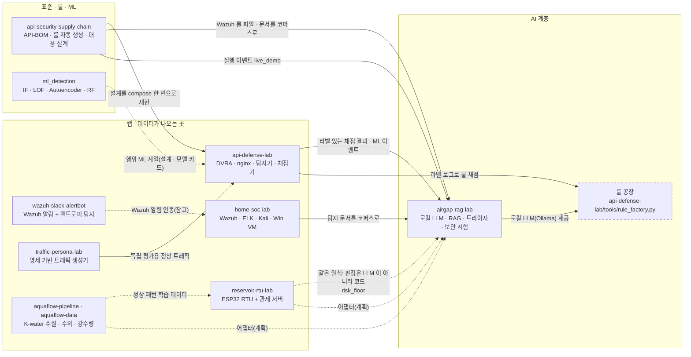
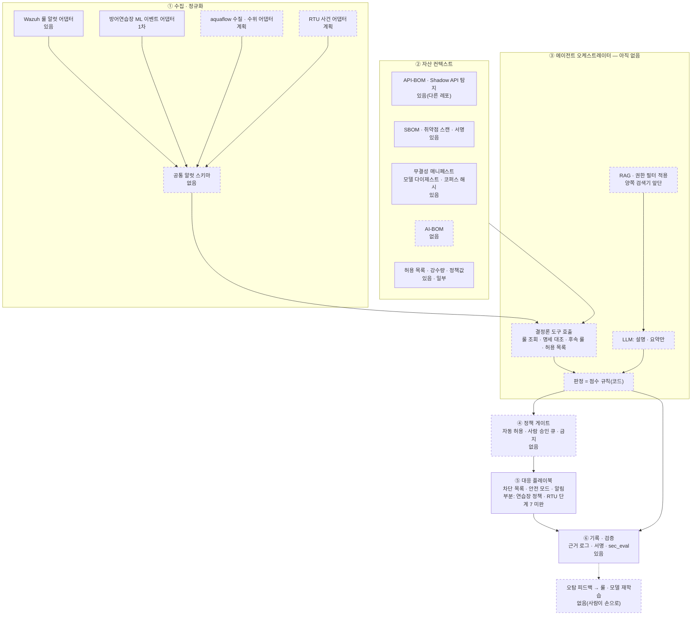
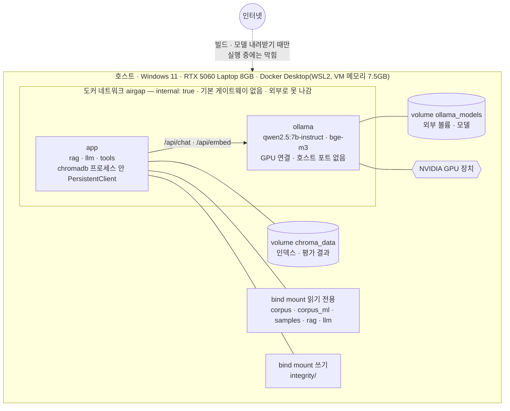
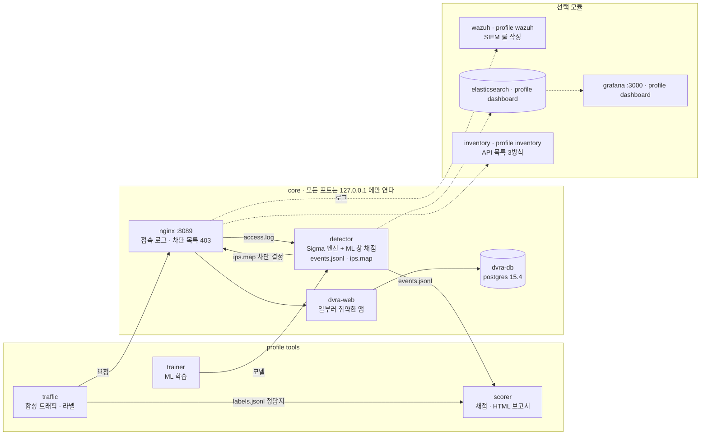
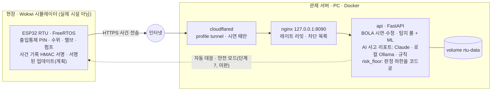
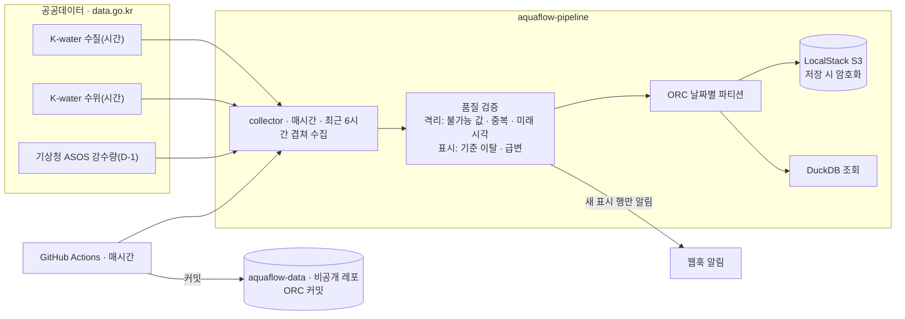
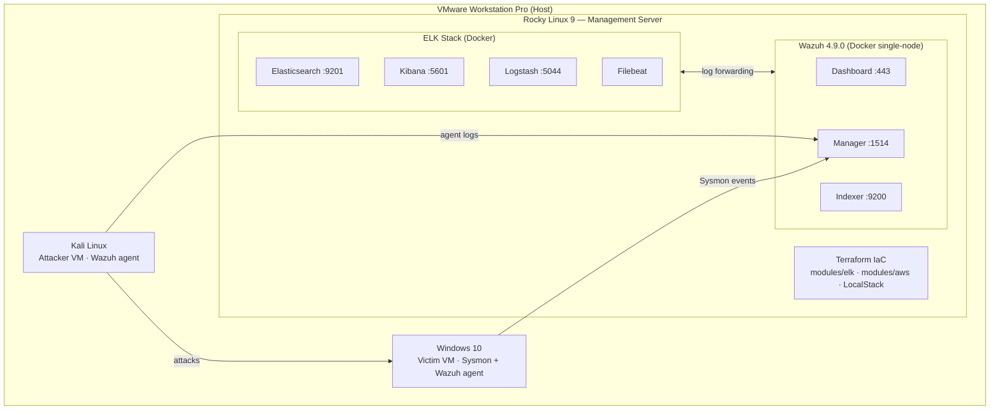

# 토폴로지 — 레포 지도 · 목표 구조 · 실행 구조

내 레포 전체를 보고 정리한 지도다. 각 그림은 **각 레포의 README·compose·문서에서 읽은 것**만 그렸고, 읽어서 확인하지 못한 관계는 맨 아래 "확인하지 못한 것"에 따로 적었다.
GitHub 에서 Mermaid 로 렌더링된다. 실선 = 지금 있음, 점선 = 아직 없음(계획).

## 1. 레포 지도 — 누가 누구에게 무엇을 주나

참고(별도 주제): `enterprise-network-lab`(Packet Tracer 멀티 사이트 네트워크), `pfsense-openvpn-acl-lab`(pfSense VPN·ACL), `multicloud-dr-petclinic`, `openssf-study` — AI SecOps 와 직접 연결되지는 않는다.

## 2. 목표 구조 — AI SecOps 의 논리 토폴로지 (현재 상태 표시)

설계 원칙(이 랩의 측정 결과에서 나옴): **LLM 은 제안·설명만 하고 판정과 실행은 코드가 한다.** 변경 조치는 사람 승인(HITL)을 거친다.

지금 흩어져 있는 구현: 트리아지 스크립트(`rag/triage.py`, `triage_ml.py`) · 룰 공장 · 보안 시험 하네스(`rag/sec_eval.py`) · 무결성·서명 도구가 각각 따로 돈다. ③과 ④(오케스트레이터와 정책 게이트)가 이어 붙일 자리다.

## 3. 실행 토폴로지 — 컨테이너 · 네트워크 · 신뢰 경계

### 3-1. airgap-rag-lab (`docker-compose.yml`)

신뢰 경계: ① `airgap` 네트워크 밖으로 나가는 경로가 없다(`llm/verify_airgap.py` 로 확인: `Network is unreachable`). ② 모델과 패키지는 빌드 시점에만 인터넷에서 오고, 다이제스트·해시로 고정하고 서명한다(`supply-chain/`). ③ **알럿·로그 필드는 신뢰할 수 없는 입력**이다(공격자가 만든 문자열) — 프롬프트에서 데이터로 표시하고 길이를 제한한다(인젝션 시험에서 이것만으로는 못 막음, `docs/evidence/14`).

### 3-2. api-defense-lab (`docker-compose.yml`)

### 3-3. reservoir-rtu-lab (`server/docker-compose.yml` + 펌웨어)

### 3-4. aquaflow (`docker-compose.yml` + GitHub Actions)

### 3-5. home-soc-lab (기존 README 의 구조도를 옮김)

## 4. 데이터가 레포 사이를 건너는 방식 (재현할 때 알아 둘 것)

| 건너가는 것 | 어디서 → 어디로 | 방법 | 주의 |
|---|---|---|---|
| Wazuh 룰 XML · 탐지 문서 | api-security-supply-chain · api-defense-lab · home-soc-lab → 이 레포 `corpus/` | **파일 복사** | 원본이 바뀌어도 자동으로 따라오지 않는다. 무결성 매니페스트가 이 레포 안의 변경만 잡는다 |
| 라벨 있는 채점 결과 · ML 이벤트 | api-defense-lab · api-security-supply-chain → `samples/` | 수집 스크립트(`tools/collect_lab_results.py`, `tools/build_ml_eval.py`) | 같은 생성기 출처라 독립 표본이 아니다 |
| 라벨 로그 | api-defense-lab → 룰 공장 | 읽기 전용 마운트 | 공격자 IP 대역이 라벨과 겹친다 → 평가 때 IP 무작위화 |
| 로컬 LLM | 이 레포의 `ollama` → 룰 공장 · (RTU 리포트는 자체 설정) | 같은 `airgap` 네트워크에서 `OLLAMA_URL` | 룰 공장은 이 레포의 app 이미지를 빌려 돈다 |
| 공공데이터 | data.go.kr → aquaflow → (RTU 정상 패턴 학습) | Open API · 매시간 수집 | 라벨 없음(정상만 쌓임) |

## 5. 확인하지 못한 것 (그림에서 빠진 것)

- **VM · 네트워크 주소**: `home-soc-lab`의 VM IP·서브넷과 `wazuh-slack-alertbot`의 실제 배치, 팀 프로젝트의 인프라 토폴로지는 여기에 옮기지 않았다(각 레포 README 에 있거나 원본이 다른 PC 에 있다).
- **`ml_detection` ↔ `api-defense-lab`**: 같은 계열의 행위 ML 이라는 것만 문서에서 읽었고, 코드가 직접 이어지는지는 확인하지 않았다(점선).
- **RTU 의 로컬 LLM 위치**: `report.py`가 `OLLAMA_URL` 을 쓰지만 RTU compose 에는 Ollama 서비스가 없다 — 어디의 Ollama 를 가리키는지는 설정에 달려 있다.
- **`customs-api-pipeline`, `shadow-api-lab`, `shadow_api_monitoring`** 등: 이번 지도에 넣지 않았다.
- 이 그림들은 2026-11-26 시점이다. compose·README 가 바뀌면 어긋난다.
